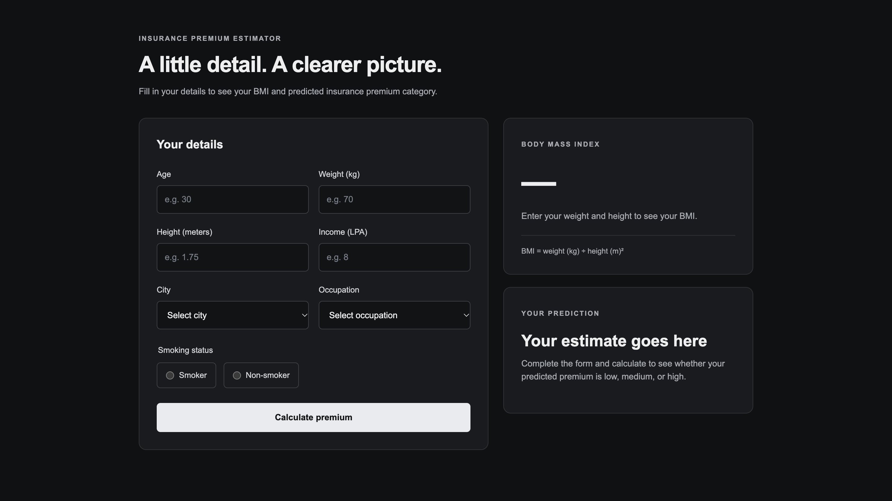
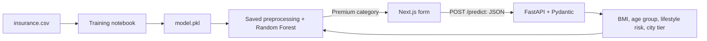
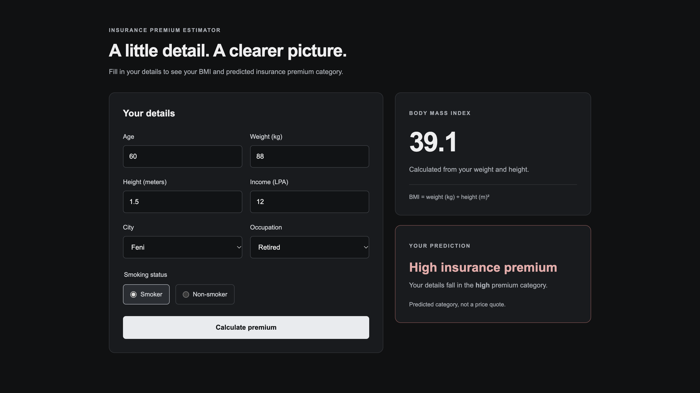
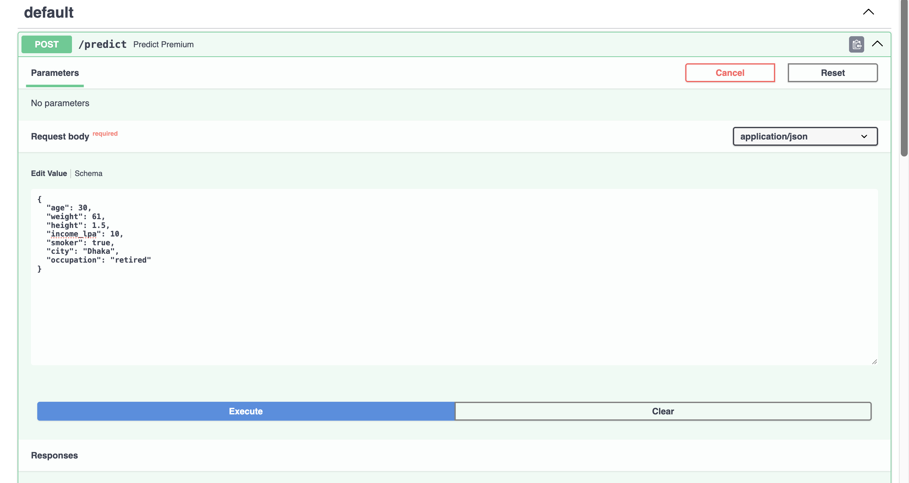
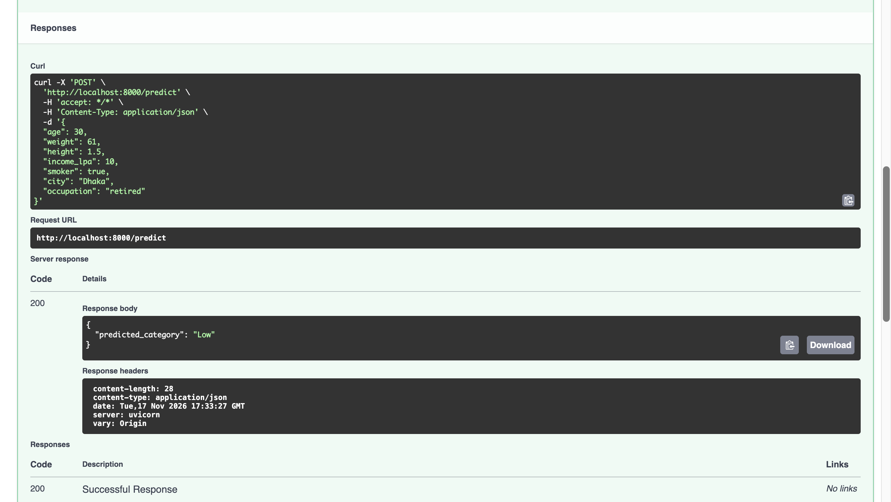

# Insurance Premium Estimator

A local machine learning demo for learners that predicts low, medium, or high insurance premium categories through a Next.js form and FastAPI backend.


Runs locally; this repository has no hosted demo.



## Contents

- [Features](#features)
- [Architecture](#architecture)
- [Screenshots](#screenshots)
- [Tech stack](#tech-stack)
- [Run locally](#run-locally)
- [Prediction API](#prediction-api)
- [Training and model](#training-and-model)
- [Limitations](#limitations)

## Features

**Form and results**

- Enter age, weight, height, income, smoking status, city, and occupation.
- See BMI update as weight and height change.
- View a clearly labeled Low, Medium, or High premium prediction.
- Use a dark, responsive layout with loading and error messages.

**Backend and model**

- Validate inputs with Pydantic before prediction.
- Calculate BMI, age group, lifestyle risk, and city tier on the server.
- Accept Bangladesh city names and common spelling variants.
- Explore the request schema through FastAPI's interactive API documentation.

## Architecture



The browser calculates BMI for immediate display. FastAPI independently calculates the model features from the submitted values, creates a one-row pandas DataFrame, and calls the saved pipeline. The pipeline encodes categorical features and predicts the premium category. There is no database or request-history storage.

| File or folder | Purpose |
| --- | --- |
| `main.py` | FastAPI endpoint, validation, derived features, and city tiers |
| `model.pkl` | Saved scikit-learn preprocessing and classifier pipeline |
| `insurance.csv` | Training dataset with 100 example rows |
| `fastapi_ml_model.ipynb` | Feature engineering, training, evaluation, and model export |
| `frontend/app/page.tsx` | Form, live BMI, API request, and prediction display |
| `frontend/app/globals.css` | Dark styling and responsive layout |
| `frontend/app/layout.tsx` | Shared root layout |

## Screenshots

### BMI and premium prediction



### FastAPI documentation

| API documentation — view 1 | API documentation — view 2 |
| --- | --- |
|  |  |


## Tech stack

| Area | Technology |
| --- | --- |
| Frontend | Next.js App Router, React, TypeScript |
| Styling | Plain CSS |
| API and validation | FastAPI, Pydantic |
| API server | Uvicorn |
| Data processing | pandas |
| Machine learning | scikit-learn, OneHotEncoder, RandomForestClassifier |
| Model storage | Python pickle file |
| Training workflow | Jupyter notebook / Google Colab |

## Run locally

### Prerequisites

- Python 3.13, as used by the development environment.
- Node.js 20.9 or newer and npm.
- The repository's `model.pkl` in the project root.

### 1. Install and start the backend

From the repository root:

```bash
python3 -m venv .venv
source .venv/bin/activate
python -m pip install -r requirements.txt
python -m uvicorn main:app --reload
```

Keep this terminal open. Run the command from the root because the API loads `model.pkl` using a relative path.

Interactive API documentation: [http://localhost:8000/docs](http://localhost:8000/docs).

### 2. Install and start the frontend

In a second terminal, from the repository root:

```bash
cd frontend
npm ci
npm run dev
```

Open [http://localhost:3000](http://localhost:3000), fill in the form, and select **Calculate premium**.

### Local configuration

- The frontend calls `http://localhost:8000/predict` in `frontend/app/page.tsx`.
- FastAPI allows requests from `http://localhost:3000` through CORS in `main.py`.
- If either port changes, update these settings together. Use `localhost:3000` for the frontend to match the allowed origin.
- No API keys or `.env` files are required. Keep any future credentials in ignored environment files; commit only templates with dummy values. Browser-side code must never contain private keys.

## Prediction API

`POST /predict` accepts JSON:

```json
{
  "age": 30,
  "weight": 70,
  "height": 1.75,
  "income_lpa": 10,
  "smoker": false,
  "city": "Dhaka",
  "occupation": "private_job"
}
```

| Field | Expected value |
| --- | --- |
| `age` | Integer, greater than 0 and less than 120 |
| `weight` | Kilograms, greater than 0 and less than 120 |
| `height` | Meters, greater than 0 and less than 3 |
| `income_lpa` | Annual income in lakhs, greater than 0; retains the original dataset's scale |
| `smoker` | Boolean: `true` or `false` |
| `city` | String; recognized cities map to Tier 1 or 2, others to Tier 3 |
| `occupation` | `retired`, `freelancer`, `student`, `government_job`, `business_owner`, `unemployed`, or `private_job` |

Successful response shape (category varies with the inputs):

```json
{"predicted_category": "Low"}
```

Invalid request values return HTTP `422`. The endpoint returns a category, not a monetary premium amount.

## Training and model

The notebook derives features, one-hot encodes categorical values, and trains a Random Forest classifier using an 80/20 train/test split. It exports the fitted pipeline as `model.pkl`.

- The notebook currently reads `/content/insurance.csv`, a Colab path. For local notebook use, change it to `insurance.csv` and run from the repository root.
- Keep the notebook's feature rules and city tiers consistent with `main.py` when retraining.
- The saved model recognizes city tiers 1, 2, and 3. With the current CSV and notebook split, Tier 3 has six training rows and no test rows.
- Keep `scikit-learn==1.6.1` for the supplied model. Loading it with another version can cause compatibility errors.
- Only load trusted pickle files; unpickling can execute code.

## Limitations

- This is a learning demo, not an insurer's quote or pricing service.
- The dataset's Indian city names were replaced with Bangladesh cities while preserving tier groups and other values. This does not make the underlying data or saved model representative of Bangladesh insurance pricing.
- Income retains the original `income_lpa` field and scale; no currency conversion was applied.
- City tiers are project-defined groupings, not an official classification.
- The dataset is small. The notebook's recorded accuracy is not evidence of real-world performance.
